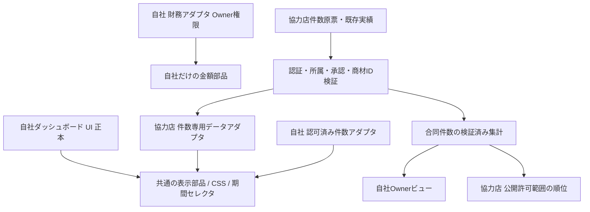

# NICO FACTORY 自社・協力店ダッシュボード統一設計 v1.1（2026-11-13）

> 状態: 設計のみ / NO DEPLOY / データ変更なし
>
> 対象: `sales-management-cc116`, https://nico-factory.web.app/, GitHub `Keikei-p/-`
>
> 調査基準: `main` `ff9051a7ee3b611e99ffec87e0383b72d259b10f`。作業時は必ず再取得し、最新 main と実本番の差分を確認する。

## 1. 目的・確定するユーザー要件

協力店のダッシュボードを**自社のダッシュボードと同じ見た目・カード順序・期間操作・件数表示**に統一する。自社の金額欄を CSS で隠すコピーではなく、協力店は**最初から件数専用の認可済みデータ**だけを受け取る。

- 既定表示: 当月の**月間**件数。前月/翌月/年月指定、日・週・月への切替、対象期間ラベル。
- 同一デザイン: ヘッダー、月選択、件数 KPI、11機能カード、開閉動作、班詳細、スマホレイアウト、読込/空/エラー状態。
- 協力店では売上、単価、CB金額、利益、金額原票、金額付き訂正履歴を**API・画面・キャッシュ・CSV・報告文・ランキングから全面除外**。
- 入力中の当日明細は変更・破棄しない。表示期間変更は**読み取り専用**、件数保存は既存の `submitPartnerWorkspaceCounts` を使う。
- 既存協力店の登録済み件数を、将来の自社件数連携・商材ON/OFF・合同ランキングにも反映する。自動移行・削除・再登録はしない。
- Ownerのみ全承認済み協力店の件数確認、訂正、商材ON/OFFと会社別例外を管理。協力店スタッフは所属会社・ロールによって許可された件数だけ閲覧。

## 2. コード調査結果（実装があることと公開済みは別）

| 対象 | 現行コードで確認したこと | 設計上の対応 |
| --- | --- | --- |
| `index.html` 5818-6019 | 自社正本: `dashboardMonth`、月間件数/売上/稼働日、11枚のカード、共通スタイル | 既存カード・配置・サイズ・折りたたみ動作を正本とする。自社画面の挙動は変更しない |
| `partner-workspace.html` 172-313 | `dashboardPartnerMonth`、`periodDay/Week/Month`、件数サマリー、同じ11カードの件数版、件数CSV | 既存実装を活用。表示月と集計期間/対象日の操作を明確にする |
| 同 644-685, 726-824 | 初期`countPeriod="month"`、最大31日、366日履歴制限、報告済み件数の集計、未確認班の隔離 | 選択期間と日付入力フォームを分離し、履歴・未報告/0件を保持 |
| 同 971-1015 | 日別 `getPartnerWorkspace` を3件ずつ並列読取、最大31日を順次取得、60秒キャッシュ、完了前は集計を出さない | 当面安全に再利用。月次専用read-only取得は**互換性試験後の性能改善候補**（急いで新API増設しない） |
| `functions-partner-workspace/index.js` 20-23 | 読取、管理、招待受諾、件数保存の4Callable | 権限と保存の正本を維持 |
| `tests/partner-dashboard-self-app-count-parity.test.mjs` | 11枚と順序、モバイルCSS、財務SDK非利用、認証切替の安全テスト | DOM/振舞いの実機テストを追加し「見た目一致」だけで完了扱いしない |
| Draft PR #690 / PR #698 | 商材公開・件数統合/順位の候補と自社Owner「協力店商材」タブ候補。安全ゲート・公開未完了 | 既存PRを再利用。古い `index.html` を本番に上書きしない |

**確認すべき公開差**: GitHub main に月間ダッシュボードがあっても、実利用の協力店画面が1日ずつしか確認できない。原因は現時点では未確定。Hosting実配備ファイル、旧PWA/Service Workerキャッシュ、アクセス導線、実アカウントの権限・読み込みエラーを分けて検証する。

## 3. 画面設計（自社と同じ配置、財務を件数に置換）

```text
┌──────────────────────────────────────────────────────────┐
│ NICO FACTORY  [ダッシュボード] [実績入力] [実績管理] [管理] │
│ 📈 月間ダッシュボード          [◀] [2026年11月 ▼] [▶]    │
│ 集計期間: [日] [週] [月●]   2026/11/01〜11/13  [更新]    │
├──────────────────────────────────────────────────────────┤
│ [期間件数  120件]  [稼働日数 10日] [報告人数 8人]           │
├──────────────────────────────────────────────────────────┤
│ [📊 件数分析]    [🏆 個人ランキング]  [📦 商材別ランキング]  │
│ [👥 班ランキング] [📈 件数グラフ]      [📋 班別詳細]         │
│ [📦 商材別]      [📣 報告文]          [🎯 目標日割り]       │
│ [📅 日別]        [📝 登録履歴]                              │
├──────────────────────────────────────────────────────────┤
│ タップしたカードの詳細（件数専用、班→担当者→商材）          │
└──────────────────────────────────────────────────────────┘
```

※上の数字はUI模式図用の架空値。実際のユーザー/件数を表していない。

- `売上分析 → 件数分析`, `収益グラフ → 件数グラフ`。月間売上KPIの位置は`報告人数`等の**非財務KPI**へ置換し3カード構造を維持。
- 班別詳細は自社と同じカード操作・階層。会社/班/担当者/商材の件数のみ。班移動後も保存時点の所属を尊重、不明は`所属班未確認`。
- 元自社アプリで非表示のカードでも、協力店にすでにある件数版機能を削除しない。表示可否は財務/ロールの安全条件で決定。
- スマホはカード2列・必要なら1列の可変表示。すべてタップ44px以上、横スクロール強制を避ける。
- 協力店の「実績入力」「登録履歴」「報告漏れ」「班・スタッフ管理」「招待」「目標」は保持。新しいダッシュボードで旧導線を消さない。

### 期間の意味

- **月別（初期）**: 月選択を集計の唯一の基準とし、当月は当日まで、過去月は月末まで。期間の全件数を表示。
- **週別**: 月曜日〜日曜日（未来日除外）。週の基準日を選ぶ。前/次週で移動。月跨ぎでも週範囲を明示。
- **日別**: 日付指定/前日・翌日を備える。**件数表示用の日付**と**件数入力フォームの日付**を独立させる。
- 年月/週/日で切り替えるとき、元の入力日付・未保存フォーム・入力内容を変更しない。
- 現行の366日表示制限は勝手に緩和しない。境界外は無言の0埋めではなく「表示不可」と出す。
- 読込失敗/通信エラー/権限拒否は数字を確定表示しない。未報告は 0 件とは別の表示。

## 4. 共通画面とデータ権限（技術設計）



- 実装方法: 自社 `index.html` を丸ごとコピーして財務を隠す**方法は禁止**。既存UIのCSSクラス・カード・構造を正本とし、**データ取得と表示を役割別に分離**する。
- 協力店のデータ取得は既存の認可済み件数Callableから。Firestore SDK/財務レスポンスを協力店ページに追加しない。
- サーバーはFirebase IDトークン、`users/{uid}`、`companies/*/members`、承認済み `partnerRelations` 等で本人・会社・Owner/Leader権限を検証する。URLクエリ・画面上のroleを信頼しない。
- 会社コードログインとメールログインの両方で、キャッシュキーに実際の認証主体/会社/ロール/期間が反映されること。ログアウト・会社切替・保存/訂正ではキャッシュ破棄。
- 金額を画面から隠すだけでは不可。GET/LIST/Callable/CSV/報告文/名前付き商材/エラー/ブラウザキャッシュ等を検査して漏洩0を証明する。
- 成功・未報告・未検証・読込失敗を別状態で表す。検証できた日付のみを勝手に月間合計へ入れて「完全」と表示しない。

## 5. 件数連携・商材公開・合同ランキングの結合契約

1. **既存件数の照合（読み取り専用）**: 会社・期間・日・班・担当者・商材別に正本と集計結果を突合。既存登録分は再入力させず、1件も勝手に加算/消去しない。
2. **商材ON/OFF**: 自社Ownerの `rankingProductVisibility/shared` と会社別例外を正本とし、ON商材だけ新規協力店入力を許可。OFFの過去件数/履歴は保持し再ON時に再表示可能。サーバーが保存拒否を強制。
3. **商材紐付け**: `rankingSkuMappings/shared` のOwner承認済み商品ID対応だけを本番集計に採用。同一名称の正規化完全一致は**候補提示のみ**、複数候補/未一致を自動確定しない。
4. **SB光/AIR旧合算**: 既存の合算件数は旧分類として1度だけ保存・表示。承認なしで光とAIRに割り振らない。光/AIRの既存ランキングへ反映する際も重複計上なし・旧合算の内訳不明を明示し、将来の分離まで原票を変更しない。
5. **合同ランキング**: `getVerifiedJointCountRanking` 等の既存検証済み読取を再利用し、合同（初期）/自社のみ/協力店のみ、日/週/月、商材・会社・班・個人を連動。人数/順位は件数降順、同件数は同順位、未報告は順位を付けない。本人公開名を使い、生IDや金額を配らない。
6. **Owner訂正**: 既存 `listHubPartnerCounts`/`correctHubPartnerCounts` v3を再利用。訂正理由必須・append-only監査・訂正前後の再GET一致・順位キャッシュ更新。協力店本人入力を止めたり所属を変更したりしない。
7. **同じ期間契約**: ダッシュボード件数、商材別・班別・個人順位、Owner協力店管理で期間・件数対象の定義を揃え、`0件` と `未報告` を混同しない。

## 6. 実装順と変更候補

| ステップ | 作業 | 変更候補 | 完了条件 |
| --- | --- | --- | --- |
| A | 本番差分の確定 | 読取専用監査、Service Worker・Hosting版・ログイン別導線 | 1日限定に見える原因を特定 |
| B | 共通UI/期間操作 | `partner-workspace.html` + 小さい共通モジュール/スタイル（必要時のみ） | 当月・過去月、日/週/月・件数だけの11カード・スマホ実機 |
| C | 既存月間件数の検証 | 既存 `getPartnerWorkspace` 読取/集計・必要な最小限のread-only拡張 | 月次の全日・会社/班/個人/商材の件数一致、認可 |
| D | 自社Owner協力店商材タブ | 既存 PR #698 と商材公開画面の**最新mainとの安全統合** | ON/OFF・会社別例外の保存/再取得 |
| E | 既存件数マッピングと合同順位 | 既存 PR #690、検証済み集計API | 保存→自社反映→訂正→再順位、既存件数網羅 |
| F | 公開 | Manual Release Gate のみ | 財務拒否・バックアップ復元・Owner/協力店実UID・公開後検査がすべて PASS |

- **注意**: #698 と #690 は設計時点の旧mainベースのPR。上書き・無検証のcherry-pick/mergeを禁止。live Hosting版と最新mainを比較し、現在本番にある機能・売上・ユーザー・件数を保持する。
- Bの改善だけなら新しい財務権限は不要。C-Eの公開は独立ゲートを満たしてから。既存の入力機能に影響するRules変更を先行しない。
- 月間で31日×1Callableになる現行ループは性能測定後に最適化する。read-only集約APIが必要かはメトリクスで判断（先に大規模改造しない）。

## 7. テスト・公開前ゲート

### 自動テスト
- `node --test tests/partner-dashboard-self-app-count-parity.test.mjs tests/partner-count-dashboard.test.cjs` を最低限実行。
- 月初・月末・うるう年・未来日・週跨ぎ・366日境界、月選択と入力フォーム日付の分離。
- 31日全件の合計/班/個人/商材、未報告/0件、訂正、班移動、公開OFF→ON、旧合算、重複SKU。
- 読込競合・アカウント切替・会社コード/メール・API権限エラー・部分読込・リトライ・CSV。
- スマホ幅 390px とデスクトップ 1280px の操作・画面比較。11枚の順序・目標・履歴・入力保存の回帰。
- 協力店認証で `products/records/recordCorrections/revenueGoals` 等の財務原票 GET/LIST 拒否。自社Ownerの正式許可を壊さない。
- `AGENTS.md` の Sales regressions、Firestore Emulator、Finance tests とリリースゲートも遵守。

### 実環境チェック（「本番完成」の必須条件）
- 本番実アカウント（自社Owner/協力店Owner/Leader/Member）で当月・前月の月別合計と日別保存を一致確認。
- 協力店で金額・単価・CBの表示なし**かつ**API/原票アクセス拒否。
- 新規入力、保存後即反映、Owner訂正、元件数を二重加算しない合同順位を検証。
- Firestoreバックアップ全件照合・隔離復元。未完了なら公開停止。
- `nico-factory.web.app` の配備内容を確認し、旧PWA/キャッシュと実機表示差を確認。
- GitHub保護ブランチ・署名・手動公開承認を維持。配備/公開後確認がない状態で「本番完了」と報告しない。

## 8. この設計PRの範囲

**本ファイルのみを追加**。HTML、JS、Firestore、Functions、Rules、Auth、Hosting、ユーザー・売上・件数、デプロイ設定は一切変更しない。次工程の実装は最新mainに追従した別の小規模PRで行い、必ずテスト・差分・本番保護を確認する。
